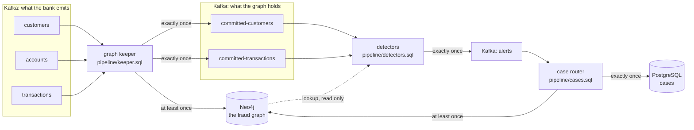

# transfer-sentry

Fraud detection on a transaction graph that [clink](https://github.com/orhaugh/clink)
keeps in Neo4j as a bank's events arrive. It takes Neo4j's
[fraud demo](https://neo4j.com/developer/demos/fraud-demo/) (its graph model,
its data and its dashboard) and runs it as a stream. Onboardings, account
openings and transfers are written into the graph as they happen. Each one is
checked against the graph around it once the graph holds it. What the checks
find is recorded exactly once, in Kafka, in a PostgreSQL case store and on the
graph itself.

The demo answers its questions over a finished database: which accounts sit
in a ring of transfers, which customers share a phone number. A bank needs the
same answers about the event in front of it, while it can still act: does this
transfer close a ring, does this applicant share an identity with a customer
already flagged. That is the question this project asks, of every event, as
it arrives.

## What it shows

- **The graph clink writes is the demo's graph.** Every relationship the
  pipeline models matches the demo's own export pair for pair, and every
  property value for value, so the demo's dashboard queries run on it
  unchanged and give the demo's answers: the same four rings, the same shared
  identifiers.
- **Questions asked of one event.** The demo's whole-graph queries, anchored on
  the event that has just arrived: a ring is found by the transfer that closes
  it, a shared identity by the customer who has just onboarded.
- **Reads that never run ahead of the writes.** A detector reads the graph only
  for events the graph is known to hold, without coordinating with the job
  that writes it (see [Why announce](#why-announce)).
- **One guarantee per output, each declared.** The graph is written at least
  once with statements that converge when a batch is written again; the
  announcements, the alerts and the case store are written exactly once.
- **Failure on purpose.** A worker is killed mid-stream and a producer resends a
  batch it had already delivered; every store is then checked against what the
  demo's data says it must hold.

## How it works



Three clink jobs, each a SQL file:

| Job | Reads | Writes |
| --- | --- | --- |
| Graph keeper | customers, accounts, transactions | the graph, in the demo's model; committed-customers and committed-transactions, one record per event once the graph holds it |
| Detectors | committed-customers, committed-transactions | alerts, each keyed by the event that raised it |
| Case router | alerts | the case store; an Alert node on the graph, linked to what raised it and to its evidence |

The detectors ask two questions of the graph, through clink's Neo4j lookup:

- **Does this transfer close a ring?** The demo's Rings query: money leaves an
  account and comes back to it through 3 to 16 distinct accounts, each transfer
  later than the one before and between 80% and 100% of its amount. The
  transfer that closes a ring is its latest, so every other transfer of the
  ring is already in the graph when that one is read.
- **Does this new customer share an identity?** The demo's shared-identifier
  query, asked at onboarding: which customers who were already customers
  share this one's email address, phone number or street address, and how many
  of them the bank has flagged as fraud. A shared address alone is low
  severity; a shared email address or phone number medium; anything shared
  with a flagged customer high.

## Why announce

A lookup reads the graph as it is when the read runs. The graph is written by
another job, and nothing in a read can prove that job has written the event the
read is about: a Neo4j bookmark names transactions already visible, not ones
another writer has yet to commit. So the detectors do not read the bank's
streams. They read the keeper's announcements, and an announcement only
becomes visible once the graph holds its event.

That rests on three things clink provides:

1. The keeper writes the graph and its announcements in one job. The graph
   sink commits everything it received before a checkpoint barrier before it
   acknowledges the checkpoint, and the announcement sink writes into a Kafka
   transaction that commits only when the checkpoint completes, which is after
   every sink has acknowledged.
2. Both statements that read a table read it through one reader
   (`shared_reader='true'`), so the graph write and the announcement are cut at
   the same barriers. With a reader each, one could have read further than the
   other when a checkpoint was taken.
3. Each sink is held to the guarantee its own table declares. The Neo4j tables
   declare `at_least_once`; the announcement tables `exactly_once`.

A detector reading `committed-transactions` with `read_committed` (the
default) therefore never sees a transaction before the graph holds it, or
before the graph holds everything that arrived ahead of it. The price is
latency: a transaction is checked about one checkpoint interval after it
arrives.

## What a run checks

`tools/check_run.py` reads every store through a client of its own and
compares it with what the demo's export says it must hold, computed without
the pipeline:

| Store | What it must hold | Last run |
| --- | --- | --- |
| The graph | every modelled relationship and property as the demo exports them, the same graph as a clean load of the same statements, and the demo's own Rings and shared-identifier answers | identical |
| committed-customers, committed-transactions | every onboarding and transaction, read with `read_committed` | all 74 and all 300, and the 20 resent transactions announced again |
| alerts | the 54 alerts the demo's data implies, 4 rings and 50 shared identities, each once | 54, none twice |
| The case store | one row per alert | 54 |
| The alert graph | one Alert node per alert, linked to what raised it and to its evidence | 54 |

In that run a Worker was killed with SIGKILL while the second half of the
transactions was flowing, with 186 of the 300 in the graph, and every job
restored from its last completed checkpoint. A producer then resent 20
transactions it had already delivered. The keeper writes each resent record
again, which the graph absorbs and the announcements carry, and the detectors
read each event once (`SELECT DISTINCT`, remembered for an hour), so no alert
is raised twice.

## What it asked of clink

Two capabilities were added to clink for this project:

- **A guarantee per sink.** A statement set used to be held to the strongest
  guarantee any of its tables declared, so the keeper, which writes Neo4j at
  least once beside exactly-once Kafka tables, was refused at submission.
  Each sink is now held to the guarantee its own table declares, through its
  own sources; a table that declares none is still held to the strongest.
- **One reader per table.** `shared_reader='true'` gives every statement of a
  job that reads a Kafka table one consumer between them, cut at the same
  checkpoint barriers.

Both are on clink's main branch after v0.12.2.

## Running it

```bash
CLINK_BIN_DIR=/path/to/clink/build ./run.sh
```

It needs Docker, Python 3 and a build of clink's main branch (`clink_node`
and `clink`); clink runs on the host, and reaches the services through their
host ports.

`run.sh` fetches the demo at a pinned commit (checked against
`scripts/neo4j-demo.sha256`), turns it into the three event streams, starts
Kafka, Neo4j and PostgreSQL in Docker, and runs a Coordinator and two Workers
from the clink build. It submits the three jobs, sends the onboardings, the
accounts and the first half of the transactions, sends the rest one every
50 ms and kills a Worker with SIGKILL while they flow, starts it again, resends
a batch as a producer that retried would, and then checks every store.

To check the graph statements and the detector reads against Neo4j without
clink, `tools/graph_check.py` applies them as the sink and the lookup do,
including out of order, duplicated, and three times over.

## Credits

The graph model, data and dashboard queries are from Neo4j's fraud demo,
[neo4j-product-examples/demo-fraud](https://github.com/neo4j-product-examples/demo-fraud),
under the Apache License 2.0; see [NOTICE](NOTICE). The demo's files are not
in this repository: `scripts/fetch-demo.sh` downloads them.
