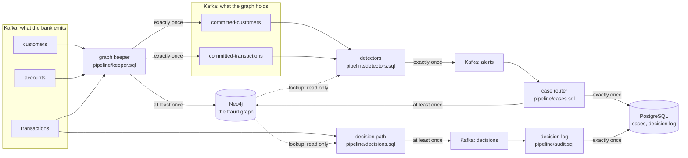

# transfer-sentry

Fraud detection on a transaction graph that [clink](https://github.com/orhaugh/clink)
keeps in Neo4j as a bank's events arrive. It takes Neo4j's
[fraud demo](https://neo4j.com/developer/demos/fraud-demo/) (its graph model,
its data and its dashboard) and runs it as a stream. Onboardings, account
openings and transfers are written into the graph as they happen. Each one is
checked against the graph around it once the graph holds it, and every
transfer is decided as it arrives, hold, review or approve, from where the
money is going. What the checks find is recorded exactly once, in Kafka, in a
PostgreSQL case store and on the graph itself; every decision is published the
moment it is made and logged exactly once in PostgreSQL.

The demo answers its questions over a finished database: which accounts sit
in a ring of transfers, which customers share a phone number. A bank needs the
same answers about the event in front of it, while it can still act: does this
transfer close a ring, does this applicant share an identity with a customer
already flagged, is this payment going to an account in a mule network.
Those are the questions this project asks, of every event, as it arrives.

## What it shows

- **The graph clink writes is the demo's graph.** Every relationship the
  pipeline models matches the demo's own export pair for pair, and every
  property value for value, so the demo's dashboard queries run on it
  unchanged and give the demo's answers: the same four rings, the same shared
  identifiers.
- **Questions asked of one event.** The demo's whole-graph queries, anchored on
  the event that has just arrived: a ring is found by the transfer that closes
  it, a shared identity by the customer who has just onboarded.
- **Reads that never run ahead of the writes.** A detector reads the graph only
  for events the graph is known to hold, without coordinating with the job
  that writes it (see [Why announce](#why-announce)).
- **A decision on every transfer, timed.** Each transfer is decided from the
  payee's place in the graph as it arrives, and every run measures how long
  each decision took, from the transfer reaching Kafka to the decision
  reaching Kafka and to the decision log.
- **Mule-chain context.** A decision reads not only who owns the payee account
  but whom that owner shares an email address, phone number or street address
  with, one and two steps away, and which of them the bank has flagged.
- **One guarantee per output, each declared.** The graph is written at least
  once with statements that converge when a batch is written again; the
  announcements, the alerts and the case store are written exactly once; a
  decision is published at least once, the moment it is made, and logged
  exactly once.
- **Failure on purpose.** A worker is killed mid-stream and a producer resends a
  batch it had already delivered; every store and every decision is then
  checked against what the demo's data says it must hold.

## How it works



Five clink jobs, each a SQL file:

| Job | Reads | Writes |
| --- | --- | --- |
| Graph keeper | customers, accounts, transactions | the graph, in the demo's model; committed-customers and committed-transactions, one record per event once the graph holds it |
| Detectors | committed-customers, committed-transactions | alerts, each keyed by the event that raised it |
| Case router | alerts | the case store; an Alert node on the graph, linked to what raised it and to its evidence |
| Decision path | transactions | decisions: hold, review or approve for every transfer, with the reasons and the evidence |
| Decision log | decisions | the decision log, one row per transfer |

The detectors ask two questions of the graph, through clink's Neo4j lookup:

- **Does this transfer close a ring?** The demo's Rings query: money leaves an
  account and comes back to it through 3 to 16 distinct accounts, each transfer
  later than the one before and between 80% and 100% of its amount. The
  transfer that closes a ring is its latest, so every other transfer of the
  ring is already in the graph when that one is read.
- **Does this new customer share an identity?** The demo's shared-identifier
  query, asked at onboarding: which customers who were already customers
  share this one's email address, phone number or street address, and how many
  of them the bank has flagged as fraud. A shared address alone is low
  severity; a shared email address or phone number medium; anything shared
  with a flagged customer high.

## Why announce

A lookup reads the graph as it is when the read runs. The graph is written by
another job, and nothing in a read can prove that job has written the event the
read is about: a Neo4j bookmark names transactions already visible, not ones
another writer has yet to commit. So the detectors do not read the bank's
streams. They read the keeper's announcements, and an announcement only
becomes visible once the graph holds its event.

That rests on three things clink provides:

1. The keeper writes the graph and its announcements in one job. The graph
   sink commits everything it received before a checkpoint barrier before it
   acknowledges the checkpoint, and the announcement sink writes into a Kafka
   transaction that commits only when the checkpoint completes, which is after
   every sink has acknowledged.
2. Both statements that read a table read it through one reader
   (`shared_reader='true'`), so the graph write and the announcement are cut at
   the same barriers. With a reader each, one could have read further than the
   other when a checkpoint was taken.
3. Each sink is held to the guarantee its own table declares. The Neo4j tables
   declare `at_least_once`; the announcement tables `exactly_once`.

A detector reading `committed-transactions` with `read_committed` (the
default) therefore never sees a transaction before the graph holds it, or
before the graph holds everything that arrived ahead of it. The price is
latency: a transaction is checked about one checkpoint interval after it
arrives.

## Deciding every transfer

The detectors wait for the graph to hold an event; a payment cannot wait. The
decision path reads the bank's transactions directly and decides each one as
it arrives, from what the graph already knows about where the money is going:
the payee account, its owner, and the customers that owner is connected to
through a shared email address, phone number or street address. Those
connections are the mule network a payment can be routed into, so the lookup
follows them two steps out:

| Reason | What the graph shows | Decision |
| --- | --- | --- |
| `payee_flagged` | the payee's owner is flagged as fraud | hold |
| `payee_linked` | the owner shares an identifier with a flagged customer | hold |
| `payee_high_risk` | the payee account is in a high-risk jurisdiction | review |
| `payee_near` | the owner shares an identifier with a customer who shares one with a flagged customer | review |

A transfer none of these apply to is approved. A decision carries all its
reasons and, as evidence, the flagged customers behind them, so a reviewer
sees why. The rules are a SQL `CASE` over the facts one Neo4j lookup returns.

The decision path can read the graph before the keeper has written the
transfer because it does not ask about the transfer. It asks about the
customers and accounts, which the keeper wrote when they arrived, before any
transfer: `run.sh` sends the onboardings and the accounts first and waits
until the graph holds them.

A decision is published to the `decisions` topic at least once, the moment it
is made. A restore decides again the transfers read after its checkpoint, and
a transfer a producer resent is decided again, each time the same way, so a
consumer keeps the first decision for each transaction. The decision log
reads each decision once and writes it exactly once into PostgreSQL, in a
transaction that commits when the job's checkpoint completes.

## How long a decision takes

`tools/check_decisions.py` times every decision from when its transfer
reached Kafka; the `transactions` and `decisions` topics are stamped with the
time each record arrived.

| From the transfer reaching Kafka to | p50 | p90 | p99 |
| --- | --- | --- | --- |
| the Neo4j lookup's reply, the decision's context | 15 ms | 22 ms | 250 ms |
| the decision reaching Kafka | 23 ms | 29 ms | 281 ms |
| the decision log's row committing in PostgreSQL | 951 ms | 1,854 ms | 2,009 ms |

Those are the first 150 transfers of the last run, sent one every 20 ms
while nothing was failing, on one machine, with Kafka, Neo4j and PostgreSQL
in Docker and clink on the host. The ten slowest decisions were the run's first
ten transfers. Neo4j plans the lookup's statement the first time it runs,
which takes a few hundred milliseconds, and the transfers that arrive
meanwhile wait for the plan; after it, a decision is on the topic in tens of
milliseconds.

The decision log trails the decision by about a second. It writes each row
exactly once, in a transaction that commits when its job's checkpoint
completes, every two seconds here. The decision is the topic; the log is the
record of it.

The context read is timed on clink's clock and the other stages on the
broker's and PostgreSQL's, which run in Docker and can differ from the host's
by a millisecond or two. How long the feeder itself took to get each
transfer to Kafka is reported apart, and is not in these figures.

## What a run checks

`tools/check_run.py` reads every store through a client of its own and
compares it with what the demo's export says it must hold, computed without
the pipeline, and `tools/check_decisions.py` does the same for every decision,
computing each from the event streams alone:

| Store | What it must hold | Last run |
| --- | --- | --- |
| The graph | every modelled relationship and property as the demo exports them, the same graph as a clean load of the same statements, and the demo's own Rings and shared-identifier answers | identical |
| committed-customers, committed-transactions | every onboarding and transaction, read with `read_committed` | all 74 and all 300, and the 20 resent transactions announced again |
| alerts | the 54 alerts the demo's data implies, 4 rings and 50 shared identities, each once | 54, none twice |
| The case store | one row per alert | 54 |
| The alert graph | one Alert node per alert, linked to what raised it and to its evidence | 54 |
| decisions | a decision for every transfer, each the one the demo's data implies, computed without the graph, and every copy of it the same | all 300 right, and 36 published again after the restore, each the same |
| The decision log | one row per transfer, each as expected | 300, one per transfer |

In that run a Worker was killed with SIGKILL while the second half of the
transactions was flowing, with 166 of the 300 in the graph, and every job
restored from its last completed checkpoint. A producer then resent 20
transactions it had already delivered. The keeper writes each resent record
again, which the graph absorbs and the announcements carry, and the detectors
read each event once (`SELECT DISTINCT`, remembered for an hour), so no alert
is raised twice. The decision path decides again the transfers it had read
after its checkpoint, the same way, and the decision log holds each once.

## What it asked of clink

Two capabilities were added to clink for this project:

- **A guarantee per sink.** A statement set used to be held to the strongest
  guarantee any of its tables declared, so the keeper, which writes Neo4j at
  least once beside exactly-once Kafka tables, was refused at submission.
  Each sink is now held to the guarantee its own table declares, through its
  own sources; a table that declares none is still held to the strongest.
- **One reader per table.** `shared_reader='true'` gives every statement of a
  job that reads a Kafka table one consumer between them, cut at the same
  checkpoint barriers.

Both are on clink's main branch after v0.12.2.

## Running it

```bash
CLINK_BIN_DIR=/path/to/clink/build ./run.sh
```

It needs Docker, Python 3 and a build of clink's main branch (`clink_node`
and `clink`); clink runs on the host, and reaches the services through their
host ports.

`run.sh` fetches the demo at a pinned commit (checked against
`scripts/neo4j-demo.sha256`), turns it into the three event streams, starts
Kafka, Neo4j and PostgreSQL in Docker, and runs a Coordinator and two Workers
from the clink build. It submits the five jobs, sends the onboardings and the
accounts and waits until the graph holds them, sends the first half of the
transactions one every 20 ms, sends the rest one every 50 ms and kills a
Worker with SIGKILL while they flow, starts it again, resends a batch as a
producer that retried would, and then checks every store and every decision.

To check the graph statements and the detector reads against Neo4j without
clink, `tools/graph_check.py` applies them as the sink and the lookup do,
including out of order, duplicated, and three times over.

## Credits

The graph model, data and dashboard queries are from Neo4j's fraud demo,
[neo4j-product-examples/demo-fraud](https://github.com/neo4j-product-examples/demo-fraud),
under the Apache License 2.0; see [NOTICE](NOTICE). The demo's files are not
in this repository: `scripts/fetch-demo.sh` downloads them.
