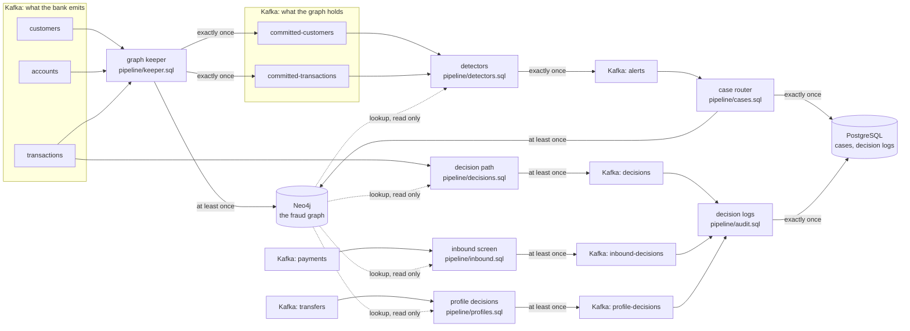

# transfer-sentry

Fraud detection on a transaction graph that [clink](https://github.com/orhaugh/clink)
keeps in Neo4j as a bank's events arrive. It takes Neo4j's
[fraud demo](https://neo4j.com/developer/demos/fraud-demo/) (its graph model,
its data and its dashboard) and runs it as a stream. Onboardings, account
openings and transfers are written into the graph as they happen. Each one is
checked against the graph around it once the graph holds it, and every
transfer is decided as it arrives, hold, review or approve, from where the
money is going. On the receiving side, payments into the bank's own accounts
are screened as they land and again as the money leaves, for the marks of a
money mule, and transfers out are judged against what is usual for the payer
and the payee, from profiles the stream keeps up to the transfer itself. What
the checks find is recorded exactly once, in Kafka, in a
PostgreSQL case store and on the graph itself; every decision is published the
moment it is made and logged exactly once in PostgreSQL.

The demo answers its questions over a finished database: which accounts sit
in a ring of transfers, which customers share a phone number. A bank needs the
same answers about the event in front of it, while it can still act: does this
transfer close a ring, does this applicant share an identity with a customer
already flagged, is this payment going to an account in a mule network, did
the money this payment sends to a high-risk jurisdiction come through other
accounts first.
Those are the questions this project asks, of every event, as it arrives.

## What it shows

- **The graph clink writes is the demo's graph.** Every relationship the
  pipeline models matches the demo's own export pair for pair, and every
  property value for value, so the demo's dashboard queries run on it
  unchanged and give the demo's answers: the same four rings, the same shared
  identifiers, the same accounts paying high-risk jurisdictions.
- **Questions asked of one event.** The demo's whole-graph queries, anchored on
  the event that has just arrived: a ring is found by the transfer that closes
  it, a shared identity by the customer who has just onboarded, and the trail
  of money into a high-risk jurisdiction by the payment that ends it.
- **Reads that never run ahead of the writes.** A detector reads the graph only
  for events the graph is known to hold, without coordinating with the job
  that writes it (see [Why announce](#why-announce)).
- **A decision on every transfer, timed.** Each transfer is decided from the
  payee's place in the graph as it arrives, and every run measures how long
  each decision took, from the transfer reaching Kafka to the decision
  reaching Kafka and to the decision log.
- **Mule-chain context.** A decision reads not only who owns the payee account
  but whom that owner shares an email address, phone number or street address
  with, one and two steps away, and which of them the bank has flagged.
- **The receiving side.** Credits into the bank's accounts are screened as
  they land, from how many credits the account has taken in the last hour and
  whom its owner is connected to, and a payment out is held when it sends a
  credit straight back out: behaviour kept by clink in event time, with the
  graph's identity links beside it.
- **Profiles kept by the stream.** A transfer out is judged against the
  payer's own history, whether the payee is new to them, and how many
  customers paid that payee for the first time that day: three windows in
  event time, each reading the one before, read in the same step as the
  decision.
- **One guarantee per output, each declared.** The graph is written at least
  once with statements that converge when a batch is written again; the
  announcements, the alerts and the case store are written exactly once; a
  decision is published at least once, the moment it is made, and logged
  exactly once.
- **Failure on purpose.** A worker is killed mid-stream and a producer resends a
  batch it had already delivered; every store and every decision is then
  checked against what the demo's data says it must hold.

## How it works



Seven clink jobs, each a SQL file:

| Job | Reads | Writes |
| --- | --- | --- |
| Graph keeper | customers, accounts, transactions | the graph, in the demo's model; committed-customers and committed-transactions, one record per event once the graph holds it |
| Detectors | committed-customers, committed-transactions | alerts, each keyed by the event that raised it |
| Case router | alerts | the case store; an Alert node on the graph, linked to what raised it and to its evidence |
| Decision path | transactions | decisions: hold, review or approve for every transfer, with the reasons and the evidence |
| Decision logs | decisions, inbound-decisions, profile-decisions | the decision log, one row per transfer; the inbound log, one row per inbound decision; the profile log, one row per transfer out |
| Inbound screen | payments | inbound-decisions: each credit credited, reviewed or held, and each onward payment that passes a credit straight through held |
| Profile decisions | transfers | profile-decisions: hold, review or approve for every transfer out, from the payer's and payee's profiles and the payee's place in the graph, with the reasons and the profile |

The detectors ask three questions of the graph, through clink's Neo4j lookup:

- **Does this transfer close a ring?** The demo's Rings query: money leaves an
  account and comes back to it through 3 to 16 distinct accounts, each transfer
  later than the one before and between 80% and 100% of its amount. The
  transfer that closes a ring is its latest, so every other transfer of the
  ring is already in the graph when that one is read.
- **Does this new customer share an identity?** The demo's shared-identifier
  query, asked at onboarding: which customers who were already customers
  share this one's email address, phone number or street address, and how many
  of them the bank has flagged as fraud. A shared address alone is low
  severity; a shared email address or phone number medium; anything shared
  with a flagged customer high.
- **Did the money in this payment to a high-risk jurisdiction come through
  other accounts?** The demo's High Risk Accounts query, asked of a payment
  into an account in a high-risk jurisdiction: what the payer has paid that
  account since the page's start date, 22 August 2024, traced back through
  accounts between which 90% to 110% of it moved, to where the money started.
  Only transfers up to the payment count, so money that reached an account
  after it paid is not followed. A trace is high severity when the money
  started in a high-risk jurisdiction or passed through an account of a
  customer the bank has flagged, medium otherwise.

On the demo's data the third question finds four traces, three of one hop and
one of two. Three are high severity, because the money started in a
high-risk jurisdiction or at an account of a customer the demo flags as
fraud; one is medium. The demo's page lists 36 accounts, every account that
paid a high-risk account since its start date. Its query means to trace each
back to where the money started, but its last condition reads the payment
the query has already matched instead of a transfer of its own, so every
path back is a row, however far back it starts: 54 rows, which the checks
reproduce. The detector stops each trace where the money started. Asked that
way of the whole year, the page would find eight such chains; the detector
leaves out the four whose first transfer came after the payment they would
explain.

## Why announce

A lookup reads the graph as it is when the read runs. The graph is written by
another job, and nothing in a read can prove that job has written the event the
read is about: a Neo4j bookmark names transactions already visible, not ones
another writer has yet to commit. So the detectors do not read the bank's
streams. They read the keeper's announcements, and an announcement only
becomes visible once the graph holds its event.

That rests on three things clink provides:

1. The keeper writes the graph and its announcements in one job. The graph
   sink commits everything it received before a checkpoint barrier before it
   acknowledges the checkpoint, and the announcement sink writes into a Kafka
   transaction that commits only when the checkpoint completes, which is after
   every sink has acknowledged.
2. Both statements that read a table read it through one reader
   (`shared_reader='true'`), so the graph write and the announcement are cut at
   the same barriers. With a reader each, one could have read further than the
   other when a checkpoint was taken.
3. Each sink is held to the guarantee its own table declares. The Neo4j tables
   declare `at_least_once`; the announcement tables `exactly_once`.

A detector reading `committed-transactions` with `read_committed` (the
default) therefore never sees a transaction before the graph holds it, or
before the graph holds everything that arrived ahead of it. The price is
latency: a transaction is checked about one checkpoint interval after it
arrives.

## Deciding every transfer

The detectors wait for the graph to hold an event; a payment cannot wait. The
decision path reads the bank's transactions directly and decides each one as
it arrives, from what the graph already knows about where the money is going:
the payee account, its owner, and the customers that owner is connected to
through a shared email address, phone number or street address. Those
connections are the mule network a payment can be routed into, so the lookup
follows them two steps out:

| Reason | What the graph shows | Decision |
| --- | --- | --- |
| `payee_flagged` | the payee's owner is flagged as fraud | hold |
| `payee_linked` | the owner shares an identifier with a flagged customer | hold |
| `payee_high_risk` | the payee account is in a high-risk jurisdiction | review |
| `payee_near` | the owner shares an identifier with a customer who shares one with a flagged customer | review |

A transfer none of these apply to is approved. A decision carries all its
reasons and, as evidence, the flagged customers behind them, so a reviewer
sees why. The rules are a SQL `CASE` over the facts one Neo4j lookup returns.

The decision path can read the graph before the keeper has written the
transfer because it does not ask about the transfer. It asks about the
customers and accounts, which the keeper wrote when they arrived, before any
transfer: `run.sh` sends the onboardings and the accounts first and waits
until the graph holds them.

A decision is published to the `decisions` topic at least once, the moment it
is made. A restore decides again the transfers read after its checkpoint, and
a transfer a producer resent is decided again, each time the same way, so a
consumer keeps the first decision for each transaction. The decision log
reads each decision once and writes it exactly once into PostgreSQL, in a
transaction that commits when the job's checkpoint completes.

## How long a decision takes

`tools/check_decisions.py` times every decision from when its transfer
reached Kafka; the `transactions` and `decisions` topics are stamped with the
time each record arrived.

| From the transfer reaching Kafka to | p50 | p90 | p99 |
| --- | --- | --- | --- |
| the Neo4j lookup's reply, the decision's context | 22 ms | 403 ms | 623 ms |
| the decision reaching Kafka | 28 ms | 408 ms | 631 ms |
| the decision log's row committing in PostgreSQL | 1,536 ms | 2,330 ms | 2,618 ms |

Those are the first 150 transfers of the last run, sent one every 20 ms while
nothing was failing, on one machine, with Kafka, Neo4j and PostgreSQL in
Docker and clink on the host. The thirty-five slowest decisions were the
run's first thirty-five transfers. Neo4j plans a lookup's statement the first
time it runs it, and the transfers that arrive meanwhile wait for the plan.
The decision path, the inbound screen and the profile job start reading
together, each with a lookup of its own, and the first decisions of each
waited more than half a second. From the 37th transfer on, every decision was
on the topic in 16 to 84 ms, all but four under 50 ms.

The decision log trails the decision by about a second and a half. It writes
each row exactly once, in a transaction that commits when its job's
checkpoint completes, every two seconds here. The decision is the topic; the
log is the record of it.

The context read is timed on clink's clock and the other stages on the
broker's and PostgreSQL's, which run in Docker and can differ from the host's
by a millisecond or two. How long the feeder itself took to get each
transfer to Kafka is reported apart, and is not in these figures.

## Screening what comes in

A mule account takes money from many payers and sends it on within minutes.
Under the UK's reimbursement rules for authorised push payment fraud, the bank
that received the money pays half of what is refunded, so the receiving bank
has two moments to act: when a credit lands, and when the money leaves again.

The demo's transactions are a year at the granularity of a day, too coarse to
show either. `tools/payment_flows.py` writes a second stream, `payments`, over
one synthetic morning after the demo's last transaction. It uses the demo's
own internal accounts, so the graph knows every account's owner and whom that
owner is connected to, and it is seeded, so every run writes the same stream:

| Accounts | What they do |
| --- | --- |
| 4 mules | a credit from a different payer every six to nine minutes, six to eight in all, each 85% to 97% sent on within five minutes; two have owners the graph links to a flagged customer, two do not |
| 5 near misses | three credits within an hour; 70% sent on; 95% sent on after 45 minutes; a credit sent on after a second, smaller credit landed; five credits over three hours |
| 8 ordinary | a salary, then a few bills |
| 4 known links | ordinary activity, owners one or two steps from a flagged customer |

`pipeline/inbound.sql` screens both moments:

| Moment | Reason | What it sees | Decision |
| --- | --- | --- | --- |
| A credit lands | `receiver_flagged`, `receiver_linked` | the account's owner is flagged, or shares an identifier with a flagged customer (the graph) | hold |
| | `fan_in` | the fourth credit or more into the account within the hour (`OVER`, in event time) | hold |
| | `receiver_near` | the owner is two shared identifiers from a flagged customer (the graph) | review |
| The money leaves | `pass_through` | a debit straight after a credit, of 80% to 100% of it, within half an hour (`MATCH_RECOGNIZE`) | hold the debit |

The graph holds the two linked mules' credits from the first, and behaviour
holds the other two's from their fourth. Every payment out of every mule is
held as it passes the money on, including the money from the three credits
each of those two took before fan-in counted. No near miss and no ordinary
account is held.

The stream is in time order and declares no watermark lag, so each payment's
own watermark lets both screens act on it at once: the credit window counts
it, and the pass-through pattern takes it in event-time order. A copy a
producer resends arrives behind the watermark, and both screens drop it: the
credit window does not count it twice, and the pattern does not match it
again. Each account's window and pattern state is checkpointed with the job,
so a restored worker carries on with the counts it had. A restore screens
again the payments read after its checkpoint, each the same way, so a consumer
keeps the first decision for each payment; the inbound log holds each once.

`tools/check_inbound.py` times every inbound decision from when its payment
reached Kafka:

| From the payment reaching Kafka to | p50 | p90 | p99 |
| --- | --- | --- | --- |
| the Neo4j lookup's reply, for a credit | 90 ms | 529 ms | 580 ms |
| the decision reaching Kafka | 49 ms | 517 ms | 584 ms |
| the inbound log's row committing in PostgreSQL | 1,863 ms | 2,530 ms | 2,615 ms |

Those are the decisions on the first half of the payments in the same run,
sent one every 20 ms beside the transactions and the transfers while nothing
was failing. That half took 1.2 seconds to send. The tail is its first
credits, which landed while the lookups were starting. From the 36th payment
on, every credit was decided and published in 18 to 54 ms. Payments out need
no lookup, so the fifteen onward holds, which the decision row counts too,
were quick from the first: fourteen were published in 13 to 63 ms, and one in
138 ms.

## Judging a transfer against the payer's history

The decision path judges a transfer by where the money is going. A payment can
also be wrong for the person sending it. The first payment to someone new, at
several times what they usually send, is how an authorised push payment scam
tends to look, and several customers paying the same new account in one
morning is how it looks from the bank's side. Profiles like these are often
built overnight and read at decision time; a stream can keep them current to
the transfer being decided and read them in the same step.

The demo gives each payer two or three transfers a year, too few to say what
is usual for anyone. `tools/transfer_history.py` writes a third stream,
`transfers`, from fourteen of the demo's customers: four weeks in which each
pays a few regular payees around an amount usual for them, then a morning.

| Payers | That morning |
| --- | --- |
| 4 scam victims | each pays one account outside the bank for the first time, four to eight times their usual amount; the first pays it twice, and the fourth sends an amount that is ordinary for them |
| 1 more | pays an account whose owner the graph links to a flagged customer, an ordinary amount |
| 6 near misses | a new payee, an ordinary amount; five times the usual amount to a payee paid for weeks; six times it to a new payee, with two transfers of history; one payee paid for the first time by two customers; five times the usual amount to a payee first paid thirty hours earlier |
| 3 ordinary | pay their regular payees |

`pipeline/profiles.sql` keeps three profiles, each an `OVER` window in event
time, and reads the payee's place in the graph as the decision path does:

| Profile | Kept per | As of each transfer |
| --- | --- | --- |
| history | payer | the payer's transfers in the last 28 days (`RANGE BETWEEN INTERVAL '28' DAY PRECEDING`), counted and totalled, so the average before this one |
| first payment | payer and payee | when the payer first paid this payee (`FIRST_VALUE(ts)`), so whether the payee is new: first paid within the last day |
| new payers | payee | how many payers paid this payee for the first time in the last day |

The windows of one query share a partitioning, so each profile is a window
over the one before: per payer, then per payer and payee, then per payee.

| Reason | When | Decision |
| --- | --- | --- |
| `payee_flagged`, `payee_linked` | as the decision path | hold |
| `payee_fan_in` | the payee is new, and three or more payers paid it for the first time in the last day | hold |
| `unusual_amount` | the payee is new, and the amount is at least three times the payer's average over three or more transfers in 28 days | review |
| `payee_high_risk`, `payee_near` | as the decision path | review |

The first victim's two payments and the second victim's are reviewed as
unusual amounts. With the third victim the account has its third new payer of
the day, and it is held from then on: the fourth victim's payment is held
though the amount is ordinary for them. The graph knows nothing of that
account; the profiles do. The payment to the linked account is held by the
graph. No near miss is held or reviewed, and none of the 127 transfers of the
four weeks before.

The transfers stream is in time order and declares no watermark lag, as the
payments stream does, so each transfer's own watermark lets the windows act on
it at once, and a copy a producer resends arrives behind the watermark, where
all three windows drop it. Each window's state is checkpointed with the job,
so a restored worker carries on with the profiles it had.

`tools/check_profiles.py` computes every profile from the transfers alone and
checks each decision's profile against its own, value for value, as well as
the decision, and times every decision as the other checks do:

| From the transfer reaching Kafka to | p50 | p90 | p99 |
| --- | --- | --- | --- |
| the Neo4j lookup's reply | 53 ms | 485 ms | 571 ms |
| the decision reaching Kafka | 73 ms | 494 ms | 580 ms |
| the profile log's row committing in PostgreSQL | 1,910 ms | 2,508 ms | 2,616 ms |

Those are the first 66 transfers in the same run, the start of the four
weeks, sent one every 20 ms beside the transactions and the payments while
nothing was failing. They took 1.4 seconds to send. The first of them waited
for the start described above, and the job caught up as quickly as the
decision path. From the 33rd transfer on, every decision was published in 19
to 86 ms, all but six under 50 ms. That is about what the decision path
takes, so the three windows add little to a decision.

## What a run checks

`tools/check_run.py` reads every store through a client of its own and
compares it with what the demo's export says it must hold, computed without
the pipeline; `tools/check_decisions.py` and `tools/check_inbound.py` do the
same for every decision, computing each from the event streams alone:

| Store | What it must hold | Last run |
| --- | --- | --- |
| The graph | every modelled relationship and property as the demo exports them, the same graph as a clean load of the same statements, and the demo's own Rings, shared-identifier and High Risk Accounts answers | identical |
| committed-customers, committed-transactions | every onboarding and transaction, read with `read_committed` | all 74 and all 300, and the 20 resent transactions announced again |
| alerts | the 58 alerts the demo's data implies, 4 rings, 50 shared identities and 4 traces into high-risk jurisdictions, each once | 58, none twice |
| The case store | one row per alert | 58 |
| The alert graph | one Alert node per alert, linked to what raised it and to its evidence | 58 |
| decisions | a decision for every transfer, each the one the demo's data implies, computed without the graph, and every copy of it the same | all 300 right, and 38 published again after the restore and the resend, each the same |
| The decision log | one row per transfer, each as expected | 300, one per transfer |
| inbound-decisions | a decision for every credit and every onward payment that passes a credit straight through, each the one the payments imply, computed without the graph, every copy of it the same, and nothing else | all 80 right, and none published twice |
| The inbound log | one row per inbound decision, each as expected | 80, one per decision |
| profile-decisions | a decision for every transfer out, each the one the transfers imply, computed without the graph, with the profile it was made from, every copy the same, and nothing else | all 133 right, each with the profile it was made from, and 21 published again after the restore, each the same |
| The profile log | one row per transfer out, each as expected | 133, one per transfer |

In that run a Worker was killed with SIGKILL while the second half of the
transactions was flowing, with 171 of the 300 in the graph, and every job
restored from its last completed checkpoint. A producer then resent 20
transactions, 10 payments and 10 transfers out it had already delivered. The
keeper writes each resent transaction again, which the graph absorbs and the
announcements carry, and the detectors read each event once
(`SELECT DISTINCT`, remembered for an hour), so no alert is raised twice. The
decision path decides again the transfers it had read after its checkpoint,
and the resent ones, the same way, and the decision log holds each once. The
inbound screens and the profile windows drop the resent payments and
transfers, so every profile decision published twice was one the restore
made again, the same way. The inbound screen had published nothing since its
last checkpoint, which completed less than 50 ms before the kill, so its
restore published no decision twice. The inbound and profile logs hold each
decision once.

## What it asked of clink

Four capabilities were added to clink for this project:

- **A guarantee per sink.** A statement set used to be held to the strongest
  guarantee any of its tables declared, so the keeper, which writes Neo4j at
  least once beside exactly-once Kafka tables, was refused at submission.
  Each sink is now held to the guarantee its own table declares, through its
  own sources; a table that declares none is still held to the strongest.
- **One reader per table.** `shared_reader='true'` gives every statement of a
  job that reads a Kafka table one consumer between them, cut at the same
  checkpoint barriers.
- **A window over a window.** The `OVER` aggregates of one query share a
  partitioning, and a window could not read another, so a profile per payer
  and payee could not follow one per payer. A window over a window now reads
  the first one's event-time column, and each row keeps its event time.
- **A common table expression read twice.** A query could read a CTE only
  once, so the detectors could not put the transfers they read once through
  two lookups, one for rings and one for traces. Each reference to a CTE now
  binds its query again.

All four are on clink's main branch after v0.12.2.

## Running it

```bash
CLINK_BIN_DIR=/path/to/clink/build ./run.sh
```

It needs Docker, Python 3 and a build of clink's main branch (`clink_node`
and `clink`); clink runs on the host, and reaches the services through their
host ports.

`run.sh` fetches the demo at a pinned commit (checked against
`scripts/neo4j-demo.sha256`), turns it into the three event streams and
writes the payments and the transfers beside them, starts Kafka, Neo4j and
PostgreSQL in Docker, and runs a Coordinator and two Workers from the clink
build. It submits the seven jobs, sends the onboardings and the accounts and
waits until the graph holds them, sends the first half of the transactions,
the payments and the transfers one every 20 ms, sends the rest one every 50 ms
and kills a Worker with SIGKILL while they flow, starts it again, resends a
batch of each as a producer that retried would, and then checks every store
and every decision.

To check the graph statements and the detector reads against Neo4j without
clink, `tools/graph_check.py` applies them as the sink and the lookup do,
including out of order, duplicated, and three times over.

## Credits

The graph model, data and dashboard queries are from Neo4j's fraud demo,
[neo4j-product-examples/demo-fraud](https://github.com/neo4j-product-examples/demo-fraud),
under the Apache License 2.0; see [NOTICE](NOTICE). The demo's files are not
in this repository: `scripts/fetch-demo.sh` downloads them.
